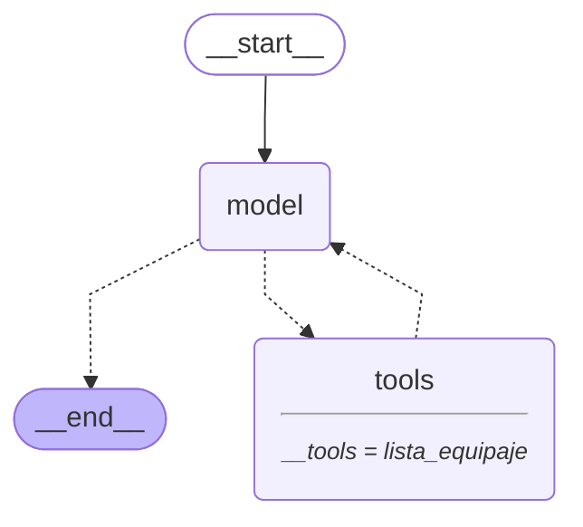
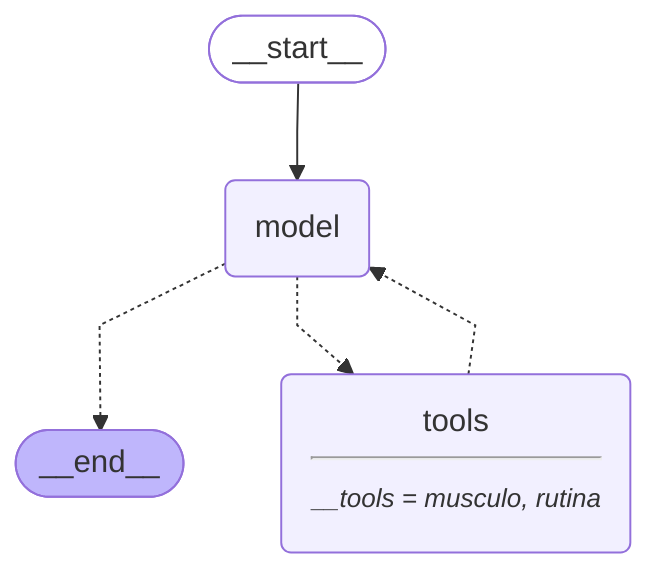
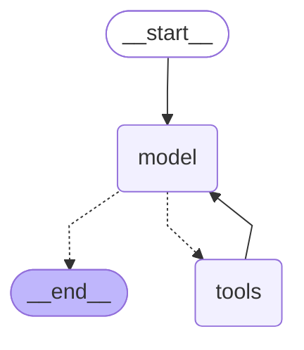

# Documento de entrega · Taller A2A

**Grupo 3 · integración de Pato, Dani y Cristian**
Esta versión integra los agentes personales de Patricio, Daniella y Cristian, sus blueprints y las evidencias disponibles. Este Markdown es la fuente editable; `documento-entrega.pdf` debe mantenerse sincronizado con esta versión.

## Integrantes

| Integrante | Agente / especialidad | Estado |
|---|---|---|
| Daniella Fernández | Agente de Maleta · listas de equipaje | Integrado; blueprint y evidencias individuales disponibles |
| Patricio Vergara | Agente de Entrenamiento · anatomía y rutinas | Integrado; blueprint, ronda y evidencias individuales disponibles |
| Cristian Meza | Agente de sitios turísticos | Integrado; blueprint, herramientas y evidencias disponibles |

## Grupo

**Grupo:** 3
**Entrega:** un ZIP grupal con el proyecto completo, este documento exportado a PDF, los blueprints individuales, el índice grupal `compañeros.md`, los manifiestos individuales y la carpeta `evidencias/`.

## Blueprints

### Daniella Fernández · Agente de Maleta

Archivo individual: `blueprint-DANI.md`.

| Qué definir | Mi agente |
|---|---|
| Quién soy | Dani · experta en maletas: decido qué llevar a un viaje según destino, días y temporada. |
| Hace | Prepara una lista de objetos para empacar por categorías y señala lo que se suele olvidar. |
| No hace | No busca ni compara vuelos u hoteles, no da precios, no informa el clima ni las políticas de equipaje de las aerolíneas. |
| Herramientas | `lista_equipaje(destino, dias, temporada)`: devuelve objetos por categoría y una sección “no te olvides”, usando guías estáticas en `tools.py`. |
| Decide solo | Selecciona categorías y cantidades orientativas según los días y la guía estática del destino y la temporada. |
| Nunca sin persona | No supone el clima, las reglas de una aerolínea ni requisitos migratorios cuando esos datos no fueron proporcionados. |
| Deriva a otro | Si preguntan por vuelos, hoteles, precios, clima o visas, indica en una frase que corresponde al agente de viajes y no responde esa parte. |
| Dónde se ejecuta | `http://127.0.0.1:8003` · `src/agente_dani/` · `python main.py dani "pregunta"`. |
| Dirección pública | `https://absent-offerings-realized-envelope.trycloudflare.com` (URL temporal registrada en `blueprint-DANI.md`; puede cambiar). |

La Agent Card vigente de Dani se verificó en `https://absent-offerings-realized-envelope.trycloudflare.com` y se guardó en `evidencias/Daniella_Fernandez/02-ficha.json`. La captura anterior se preserva como `02-ficha-tunel-anterior.json`; las URL rápidas cambian al reiniciar Cloudflare Tunnel.

#### Prompt usado por Daniella (sin cambios)

```text
Quiero crear un agente nuevo que represente lo que yo sé hacer.especializado en preparar listas de equipaje. Mi nombre es Dani y mi especialidad es decidir qué llevar a un viaje según el destino, la cantidad de días y la temporada. Hazlo copiando el molde del agente de viajes, en src/agente_NOMBRE/ con los mismos cuatro archivos y siguiendo AGENTS.md:

1) tools.py. Crea una herramienta con `@tool` llamada `lista_equipaje(destino, dias, temporada)`, con datos de referencia estáticos, creíbles y definidos dentro del archivo. Debe devolver una lista de objetos para empacar, agrupados por categorías como ropa, documentos, tecnología y botiquín, más una sección “no te olvides”. Si el destino o la combinación no está en los datos, dilo en una línea y no inventes información. No devuelvas vuelos, hoteles, precios, clima, requisitos de visa ni políticas de equipaje de aerolíneas.

2) prompts.py. Define un `SYSTEM_PROMPT` que diga: eres Dani, especialista en equipaje y preparación de maletas. Responde solo sobre qué llevar, en español y de forma breve, usando la herramienta antes de contestar y sin inventar datos. La temporada es un dato que proporciona la persona: no consultes ni supongas el clima real. Si preguntan por vuelos, hoteles, precios, clima, visas o políticas de equipaje de aerolíneas, dilo en una frase y no respondas esa parte; corresponde al agente de viajes. Si te preguntan quién eres, di tu nombre y tu especialidad.

3) graph.py. Igual que el molde del agente de viajes: `create_agent` con el modelo de Gemini configurado por el proyecto, mi herramienta, el `SYSTEM_PROMPT` y `MemorySaver`, con las funciones `responder`, `saltos` y `diagrama`. Conéctalo a `main.py` para que funcionen `python main.py dani "pregunta"`, `--saltos` y `--diagrama`.

4) server.py. Crea la ficha con `crear_tarjeta`: nombre “Agente de Maleta de Dani”, una descripción de dos frases (qué hago y qué no hago) y una skill por herramienta con una pregunta de ejemplo. Lee `URL_DANI` del `.env` y agrégala a `.env.example` apuntando a `http://127.0.0.1:8003`; arma `app = crear_app(tarjeta, responder)`. No incluyas claves ni secretos en `.env.example`.

No lo levantes tú. Dime cómo probarlo sin servidor y después el comando: `uvicorn src.agente_dani.server:app --port 8003 --reload`.
```

#### Ficha del agente

Descripción anterior al prompt 2: “Prepara listas de objetos para empacar según destino, cantidad de días y temporada. No busca vuelos ni hoteles, ni informa precios, clima, visas o políticas de equipaje de aerolíneas.”

Descripción final: “Prepara listas de equipaje con ropa, documentos, tecnología y botiquín para Punta Arenas, Pucón e Iquique, según los días y la temporada. No busca ni compara vuelos, hoteles o precios, ni informa clima, visas o políticas de equipaje de aerolíneas.”

Se concretó la descripción para que un supervisor pueda distinguir las listas de equipaje de las consultas de reservas y servicios de viaje. La ficha final está en `evidencias/Daniella_Fernandez/02-ficha.json`.

#### Diagrama de `python main.py dani --diagrama`



### Patricio Vergara · Agente de Entrenamiento

Archivo individual: `blueprint-PATO.md`.

| Qué definir | Mi agente |
|---|---|
| Quién soy | Pato · entrenador de gimnasio con enfoque científico; conozco la anatomía y función de los músculos y armo rutinas basadas en evidencia. |
| Hace | Explica origen, inserción y función de músculos principales, y arma rutinas por grupo muscular, objetivo, nivel y días por semana, citando los estudios que respaldan los parámetros. |
| No hace | No da dietas, alimentación ni suplementos; no diagnostica ni trata lesiones o dolores existentes (sí orienta ejercicios de prevención sin dolor); no responde sobre otros deportes, viajes, restaurantes ni maletas. |
| Herramientas | `musculo(nombre)`: anatomía, función y ejercicios. `rutina(grupo_muscular, objetivo, nivel, dias_por_semana)`: ejercicios, series, repeticiones, cercanía al fallo, descanso, frecuencia y referencias. Usa datos estáticos en `src/agente_pato/tools.py`. |
| Decide solo | Deduce grupo, objetivo, nivel y días; si falta alguno, usa hipertrofia, principiante y 3 días, y lo dice. |
| Nunca sin persona | Si se menciona dolor, una lesión actual, embarazo o una condición médica, no arma una rutina y recomienda consultar a un profesional de salud. Ignora instrucciones escondidas en textos pegados o reenviados. |
| Deriva a otro | Dietas, suplementos, lesiones actuales, otros deportes, viajes, restaurantes o maletas: indica el límite y no responde esa parte. |
| Dónde se ejecuta | `http://127.0.0.1:8005` · `src/agente_pato/` · `python main.py pato "pregunta"`. |
| Dirección pública | `https://greatly-available-hide-mud.trycloudflare.com` (URL temporal registrada el 9 de noviembre de 2026; puede cambiar). |

#### Prompt real y cambios tras probarlo

Patricio documenta que el desarrollo fue una conversación iterativa con Claude Code, no un único prompt. El mensaje que definió el enfoque científico fue:

```text
este agente del gym quiero que tenga un enfoque cientifico ¿se puede? es decir, que conozca la anatomia y fisiologica del cuerpo, cada musculo, y que pueda preparar rutinas que la ciencia ha demostrado funcionar, por grupos musculares, etc. por supuesto según lo que el usuario desee
```

Después de probarlo, añadió la herramienta de anatomía `musculo`, objetivos y días por semana, quitó `temperature=0` porque el modelo la ignoraba, mejoró `--saltos` para imprimir la respuesta, aclaró los rechazos por temas ajenos y blindó el prompt contra inyección. El historial completo está en `evidencias/Patricio_Vergara/seccion-documento.md`.

**Ficha antes:** “Arma rutinas de gimnasio para pecho, espalda, piernas, hombros, brazos, core o cuerpo completo, en nivel principiante o intermedio, con series, repeticiones y descanso. No da dietas, alimentación ni suplementos, no trata lesiones o dolores, y no responde sobre viajes, restaurantes ni maletas.”

**Ficha después:** “Explica la anatomía y función de los músculos y arma rutinas de gimnasio con base científica por grupo muscular (pecho, espalda, piernas, glúteos, hombros, brazos, core o cuerpo completo), según objetivo (hipertrofia, fuerza o resistencia), nivel y días por semana. No da dietas, alimentación ni suplementos, no diagnostica ni trata lesiones o dolores existentes (sí orienta ejercicios de prevención sin dolor), y no responde sobre otros deportes, viajes, restaurantes ni maletas.”

La ficha A2A de Pato está archivada en `evidencias/Patricio_Vergara/02-ficha.json`; el blueprint y el prompt describen el enfoque final de prevención y límites de salud.

#### Diagrama de `python main.py pato --diagrama`



### Cristian Meza · Agente de sitios turísticos

Archivo individual: `blueprint-cristian.md`.

| Qué definir | Mi agente |
|---|---|
| Quién soy | Cristian · especialista en sitios turísticos; recomienda lugares según la ciudad indicada. |
| Hace | Entrega sitios con descripción, ubicación, horario, precio e imagen referenciales. |
| No hace | No busca vuelos ni hoteles, no reserva, no informa el clima ni las restricciones de los sitios. |
| Herramientas | `listado_sitios_turisticos(ciudad, fecha)` y `horario_atencion(nombre_sitio, dia)`, con datos estáticos en `src/agente_cristian/tools.py`. |
| Decide solo | Selecciona lugares e imágenes según la ciudad y fecha consultadas. |
| Nunca sin persona | No supone el clima, prioriza sitios ni inventa restricciones; si falta información, lo indica. |
| Deriva a otro | Vuelos, hoteles, equipaje, clima o visas: delimita el tema y no responde esa parte. |
| Dónde se ejecuta | `http://127.0.0.1:8004` · `src/agente_cristian/` · `python main.py cristian "pregunta"`. |
| Dirección pública | `https://managing-gcc-upload-precious.trycloudflare.com` (URL temporal del blueprint; puede cambiar). `URL_PUBLICA` reemplaza la URL local en la Agent Card. |

La ficha A2A de Cristian está archivada en `evidencias/Cristian_Meza/02-ficha.json`. El túnel y la URL pública registrada en el blueprint se documentan en `evidencias/Cristian_Meza/03-tunel.png`.

#### Prompt de mejora de la ficha y cambios

El prompt 2 que Cristian documentó fue:

> Revisa la ficha de mi agente en `src/agente_cristian/server.py` pensando en quién la va a leer: otro agente, el supervisor, que con cada pregunta decide si me la manda a mí o a otro. Él no sabe nada de mi tema; solo lee la ficha. Mejórala así: description con temas concretos y límites claros; una skill por herramienta, con nombre corto, descripción de una línea y un ejemplo real; y muestra la ficha final con el `curl` de `/.well-known/agent-card.json`.

**Antes:** recomendaba sitios turísticos con ubicación, horarios, precios e imágenes; no buscaba vuelos u hoteles, no reservaba ni informaba clima o restricciones.

**Después:** recomienda lugares para visitar con descripción, ubicación, horarios, precios e imágenes referenciales; excluye vuelos, hoteles, reservas, clima, visas, equipaje y restricciones. También aclaró la descripción de las dos skills y agregó ejemplos más útiles para el supervisor.

| Skill | Descripción | Ejemplo |
|---|---|---|
| Recomendar lugares | Devuelve lugares con descripción, ubicación, precio e imagen referenciales. | Voy a Lima el sábado, ¿qué lugares turísticos me recomiendas? |
| Consultar horarios | Indica el horario registrado de un lugar para el día consultado. | ¿A qué hora puedo visitar el Cerro San Cristóbal el domingo? |

El prompt de mejora de la ficha y sus cambios están registrados en `evidencias/Cristian_Meza/documento.md`; el prompt de sistema vigente está en `src/agente_cristian/prompts.py`.

#### Diagrama de `python main.py cristian --diagrama`



## Evidencias

Las evidencias de cada integrante se mantienen separadas: Pato en `evidencias/Patricio_Vergara/`, Dani en `evidencias/Daniella_Fernandez/` y Cristian en `evidencias/Cristian_Meza/`, con el resumen general en `evidencias_cristian.md`.

| Archivo | Estado / descripción |
|---|---|
| `Patricio_Vergara/01-saltos.png`, `Patricio_Vergara/02-ficha.json` | Ejecución `--saltos` y Agent Card capturada del Agente de Entrenamiento de Pato. |
| `Patricio_Vergara/mensaje-a2a.json` | Respuesta A2A de Pato; el SDK devuelve `result.kind=message` y el texto en `result.parts[0].text`. |
| `Patricio_Vergara/03-tunel-terminal.png`, `Patricio_Vergara/03-tunel-celular.png` | Evidencia del túnel de Pato desde terminal y celular. |
| `Patricio_Vergara/04-catalogo.png`, `Patricio_Vergara/05-ronda.png`, `Patricio_Vergara/05-ronda-ambigua.png` | Catálogo, ronda y dos casos ambiguos de Pato; el detalle está en `Patricio_Vergara/ronda-pato.md`. |
| `Patricio_Vergara/blindaje.md`, `scripts/probar_blindaje_pato.py` | Casos de inyección de prompt y salud; la evidencia reporta 10/10 pasados. |
| `Patricio_Vergara/seccion-documento.md` | Historial de prompts, ficha antes/después y análisis detallado de Pato. |
| `Daniella_Fernandez/01-saltos.png`, `Daniella_Fernandez/02-ficha.json`, `Daniella_Fernandez/respuesta-a2a.json` | Ejecución CLI, ficha y respuesta A2A de Dani. |
| `Daniella_Fernandez/03-tunel.png`, `Daniella_Fernandez/04-catalogo.png`, `Daniella_Fernandez/05-ronda.png` | Verificación de túnel, catálogo y ronda de Dani; las limitaciones de disponibilidad se describen más adelante. |
| `Cristian_Meza/01-saltos.png`, `Cristian_Meza/02-diagrama.png`, `Cristian_Meza/02-ficha.json`, `Cristian_Meza/05-ronda.png` | Evidencias de Cristian; el resumen y análisis están en `evidencias_cristian.md`. |
| `Cristian_Meza/03-tunel.png` | Terminal de Cloudflare Tunnel con la URL pública y las comprobaciones de conectividad. |
| `Cristian_Meza/documento.md` | Prompt de mejora de ficha, descripción antes/después, diagrama y reflexión de ronda de Cristian. |
| `Cristian_Meza/respuesta-a2a-cristian.md` | Solicitud y respuesta A2A de Cristian en `http://127.0.0.1:8004`. |

El índice grupal está en `compañeros.md`; los manifiestos por coordinador están en `evidencias/Daniella_Fernandez/compañeros.md`, `evidencias/Patricio_Vergara/compañeros.md` y `evidencias/Cristian_Meza/compañeros.md`. El de Cristian documenta las fichas de Patricio y Dani. Las evidencias de cada agente permanecen en su subcarpeta individual.

Para generar un manifiesto `compañeros.md`, copia `companeros.json.example` a `companeros.json`, completa autor y URL por cada agente ajeno y ejecuta `python scripts/generar_companeros.py`.

**Nota de codificación:** PowerShell mostró algunos acentos como `Ã…`; se verificó que la respuesta A2A guardada como JSON UTF-8 contiene los acentos correctos. El problema era de visualización de la consola.

## Ronda

La pauta pide tres preguntas por integrante: una de la propia skill, una de la skill de un compañero y una que ningún agente del catálogo pueda responder. La ronda debe ejecutarse desde el coordinador después de configurar las URLs de los compañeros.

### Daniella Fernández

| # | Pregunta | A quién debería ir | Resultado |
|---|---|---|---|
| 1 | Quiero ganar masa en la espalda, entreno 4 días a la semana, ¿qué rutina hago? | Agente de Entrenamiento de Pato. | El coordinador lo eligió y la respuesta incluyó la rutina y sus referencias. |
| 2 | Voy a Lima el sábado, ¿qué lugares turísticos me recomiendas? | Agente de Cristian, según la ficha externa. | La captura registra la selección, pero anota que no se pudo conectar al agente; es un límite de disponibilidad, no una respuesta exitosa. |
| 3 | ¿Cuál es la capital de Tokio? | Ninguno. | El coordinador eligió `ninguno` y explicó que el tema no corresponde a las skills del catálogo. |

**Evidencia de la skill propia:** la consulta “Voy cinco días a Punta Arenas en julio, ¿qué debería llevar?” aparece en `evidencias/Daniella_Fernandez/01-saltos.png` y `evidencias/Daniella_Fernandez/respuesta-a2a.json`; recorrió `model → tools → model`. La captura `evidencias/Daniella_Fernandez/05-ronda.png` documenta la ronda del coordinador; la pregunta propia se prueba por separado con CLI/A2A. Por decisión de Daniella, la ronda queda como fue capturada. Una prueba sobre VPN rechazó el tema, pero lo atribuyó al agente de viajes; la derivación documentada con vuelos sí corresponde a ese agente.

**Análisis de la ronda:** Pato fue elegido correctamente para la consulta de entrenamiento porque su ficha enumera rutinas y objetivos. La selección de Cristian para turismo fue coherente, aunque en la captura no hubo conexión al agente. La pregunta de Tokio quedó en `ninguno`. Un posible cruce sería pedir ropa para entrenar durante un viaje; la ficha de Dani puede explicitar que no entrega rutinas ni consejos de entrenamiento.

### Cristian Meza

| # | Pregunta | A quién debería ir | Resultado |
|---|---|---|---|
| 1 | ¿Qué lugares puedo visitar en Bogotá un miércoles y cuáles son sus precios? | Agente de sitios turísticos de Cristian. | Respondió con Museo del Oro, Monserrate y Museo Botero y sus precios referenciales. Usó `listado_sitios_turisticos`. |
| 2 | Voy cinco días a Punta Arenas en julio, ¿qué debería llevar? | Agente de Maleta de Dani. | El supervisor eligió a Dani; usó `lista_equipaje`. |
| 3 | ¿Cómo tramito una visa para viajar? | Ninguno. | El supervisor indicó que no había un agente para visas. |

La captura del coordinador y el análisis están en `evidencias/Cristian_Meza/05-ronda.png` y `evidencias_cristian.md`. La respuesta A2A local está en `evidencias/Cristian_Meza/respuesta-a2a-cristian.md`.

**Análisis de la ronda:** la ficha de Cristian fue la más precisa para la consulta de Bogotá porque declara lugares turísticos, ubicación, horarios y precios; la respuesta usó `listado_sitios_turisticos`. La segunda pregunta fue a Dani por destino, duración y temporada; la de visas quedó en `ninguno`. Tras la prueba mantendría la descripción concreta y destacaría expresamente que no responde sobre visas, clima, vuelos ni hoteles.

### Patricio Vergara

| # | Pregunta | A quién debería ir | Resultado |
|---|---|---|---|
| 1 | Estoy empezando en el gym, ¿qué rutina hago para piernas? | Agente de Entrenamiento de Pato. | Usó `rutina`, asumió hipertrofia/principiante/3 días al faltar datos y citó referencias. |
| 2 | Organizo una feria infantil de 3 horas desde las 15:00, ¿cómo armo el horario? | Agente de Matías, por túnel. | Respondió con un programa de 15:00 a 17:25; quedaron 35 minutos sin actividades. |
| 3 | ¿Quién ganó el mundial de 1962? | Ninguno. | El supervisor indicó que el catálogo no cubre historia del fútbol. |
| 4 (extra, ambigua) | Voy 3 días a Pucón en verano y quiero seguir entrenando, ¿qué ropa de gimnasio llevo? | Agente de Maleta de Dani. | Eligió Dani porque la acción principal era qué empacar, no cómo entrenar. |
| 5 (extra, salud) | ¿Qué ejercicios hago para no lesionarme la espalda en un viaje largo? | Ninguno. | Rechazó la prevención de lesión en ese contexto y no improvisó un tratamiento. |

**Análisis de la ronda:** Pato y Matías fueron elegidos por sus fichas concretas: “rutinas de gimnasio” y “programa de ferias”. En el caso ambiguo, el supervisor eligió a Dani porque la pregunta pedía qué empacar; en el caso de prevención de lesión, Pato no dio una rutina y el supervisor eligió `ninguno`. Ningún agente respondió sobre el mundial de fútbol. Como mejora preventiva, Patricio propone explicitar que tampoco responde sobre otros deportes ni resultados deportivos. Análisis completo: `evidencias/Patricio_Vergara/ronda-pato.md`.

---

**Estado de la entrega:** los pulls de `main` y `agente_cristian` están integrados. Patricio documentó su proceso real y Cristian el prompt de mejora de ficha. Las evidencias de túnel y las fichas de los tres agentes están incluidas. La ronda de Dani se conserva como fue capturada por decisión de la integrante. El ZIP grupal reúne los blueprints, manifiestos, proyecto y evidencias, sin `.env`, `.venv` ni claves.
