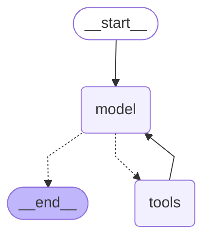

# Evidencias · Agente Cristian

## Antes y después de la ficha

### Prompt que produjo el cambio

> Revisa la ficha de mi agente en `src/agente_cristian/server.py` pensando en quién la va a leer: otro agente, el supervisor, que con cada pregunta decide si me la manda a mí o a otro. Él no sabe nada de mi tema; solo lee la ficha. Mejórala así: description con temas concretos y límites claros; una skill por herramienta, con nombre corto, descripción de una línea y un ejemplo real; y muestra la ficha final con el `curl` de `/.well-known/agent-card.json`.

### Antes

**Description:**

> Recomienda sitios turísticos con ubicación, horarios, precios e imágenes referenciales. No busca vuelos u hoteles, no reserva, no informa el clima ni restricciones.

La descripción indicaba la especialidad general, pero no detallaba suficientemente los temas que el supervisor podía derivar ni todos los temas que estaban fuera del alcance del agente. Las skills tenían nombres y ejemplos, aunque sus descripciones eran menos específicas para clasificar preguntas.

### Después

**Description:**

> Recomienda lugares para visitar con descripción, ubicación, horarios, precios referenciales e imágenes. No responde sobre vuelos, hoteles, reservas, clima, visas, equipaje ni restricciones de los sitios.

La primera frase permite identificar consultas sobre lugares, descripciones, ubicaciones, horarios, precios e imágenes. La segunda evita que el supervisor derive preguntas sobre vuelos, hoteles, reservas, clima, visas, equipaje o restricciones.

**Skills mejoradas:**

| Nombre | Descripción | Ejemplo |
|---|---|---|
| Recomendar lugares | Devuelve lugares para visitar en una ciudad con descripción, ubicación, precio e imagen referenciales. | Voy a Lima el sábado, ¿qué lugares turísticos me recomiendas? |
| Consultar horarios | Indica el horario registrado de un lugar turístico para el día consultado. | ¿A qué hora puedo visitar el Cerro San Cristóbal el domingo? |

## 01 · Saltos

### Pregunta del tema

Consulta: `¿Qué sitios turísticos puedo visitar en Lima el sábado?`

La ejecución muestra la herramienta `listado_sitios_turisticos`:


### Pregunta fuera del tema

Consulta: `¿Qué vuelos hay de Lima a Bogotá?`

El agente rechaza la consulta porque los vuelos corresponden a otro agente y no llama ninguna herramienta turística. La misma captura muestra ambos casos.

## 02 · Diagrama

Salida de `python main.py cristian "" --diagrama`:




## 05 · Ronda de preguntas

| # | Pregunta | Agente elegido | Motivo y respuesta | ¿Usó herramienta? |
|---|---|---|---|---|
| 1 | ¿Qué lugares puedo visitar en Bogotá un miércoles y cuáles son sus precios? | Agente de cristian | El supervisor detectó una solicitud de lugares para visitar y precios. Respuesta: Museo del Oro ($5.000 COP), Cerro de Monserrate ($29.000 COP ida y vuelta) y Museo Botero (entrada gratuita). | Sí, `listado_sitios_turisticos` en el agente remoto. |
| 2 | Voy cinco días a Punta Arenas en julio, ¿qué debería llevar? | Agente de Maleta de Dani | La ficha de Dani prepara listas de equipaje según destino, duración y temporada. | Sí, skill `lista_equipaje` del agente remoto. |
| 3 | ¿Cómo tramito una visa para viajar? | Ninguno | El supervisor indica que no hay un agente disponible para visas y no inventa una respuesta. | No. |

Evidencia de la ejecución con `--saltos`:

Consulta realizada desde el terminal:

```powershell
python main.py coordinador "¿Qué lugares puedo visitar en Bogotá un miércoles y cuáles son sus precios?" --saltos
```


### Comentario de la ronda

La ficha que mejor permitió elegir fue la de Cristian para la pregunta sobre Bogotá, porque especifica claramente recomendaciones de lugares para visitar y precios referenciales. El agente respondió con tres opciones concretas: Museo del Oro, Cerro de Monserrate y Museo Botero, incluyendo sus precios.

La segunda pregunta fue dirigida correctamente a Dani porque su ficha indica que prepara listas de equipaje según destino, duración y temporada. La pregunta sobre visas no correspondía a ningún agente del catálogo, por lo que el supervisor eligió “ninguno” y comunicó que no había un agente disponible. Después de la ronda mantendría la descripción de Cristian y destacaría aún más que no responde sobre visas, clima, vuelos ni hoteles.
