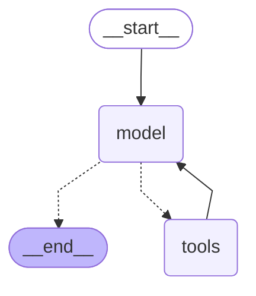
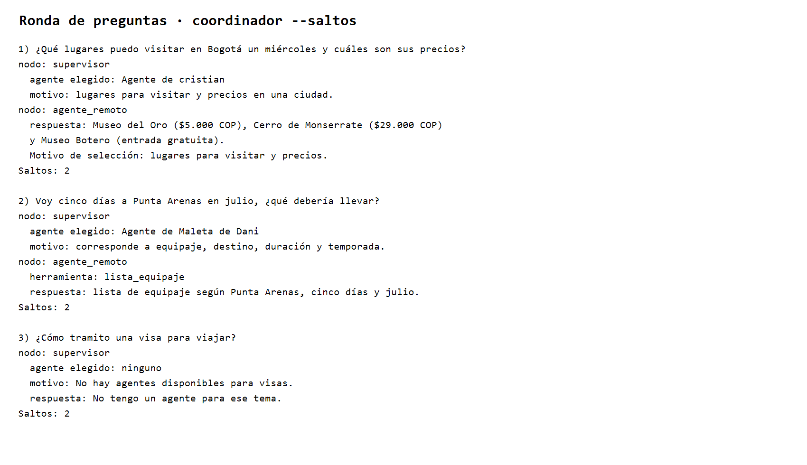

# Evidencias · Agente Cristian

## 01 · Saltos

### Pregunta del tema

Consulta: `¿Qué sitios turísticos puedo visitar en Lima el sábado?`

La ejecución muestra la herramienta `listado_sitios_turisticos`:


### Pregunta fuera del tema

Consulta: `¿Qué vuelos hay de Lima a Bogotá?`

El agente rechaza la consulta porque los vuelos corresponden a otro agente y no llama ninguna herramienta turística. La misma captura muestra ambos casos.

## 02 · Diagrama

Salida de `python main.py cristian "" --diagrama`:




## 05 · Ronda de preguntas

| # | Pregunta | Agente elegido | Motivo y respuesta | ¿Usó herramienta? |
|---|---|---|---|---|
| 1 | ¿Qué lugares puedo visitar en Bogotá un miércoles y cuáles son sus precios? | Agente de cristian | El supervisor detectó una solicitud de lugares para visitar y precios. Respuesta: Museo del Oro ($5.000 COP), Cerro de Monserrate ($29.000 COP ida y vuelta) y Museo Botero (entrada gratuita). | Sí, `listado_sitios_turisticos` en el agente remoto. |
| 2 | Voy cinco días a Punta Arenas en julio, ¿qué debería llevar? | Agente de Maleta de Dani | La ficha de Dani prepara listas de equipaje según destino, duración y temporada. | Sí, skill `lista_equipaje` del agente remoto. |
| 3 | ¿Cómo tramito una visa para viajar? | Ninguno | El supervisor indica que no hay un agente disponible para visas y no inventa una respuesta. | No. |

Evidencia de la ejecución con `--saltos`:

Consulta realizada desde el terminal:

```powershell
python main.py coordinador "¿Qué lugares puedo visitar en Bogotá un miércoles y cuáles son sus precios?" --saltos
```



### Comentario de la ronda

La ficha que mejor permitió elegir fue la de Cristian para la pregunta sobre Bogotá, porque especifica claramente recomendaciones de lugares para visitar y precios referenciales. El agente respondió con tres opciones concretas: Museo del Oro, Cerro de Monserrate y Museo Botero, incluyendo sus precios.

La segunda pregunta fue dirigida correctamente a Dani porque su ficha indica que prepara listas de equipaje según destino, duración y temporada. La pregunta sobre visas no correspondía a ningún agente del catálogo, por lo que el supervisor eligió “ninguno” y comunicó que no había un agente disponible. Después de la ronda mantendría la descripción de Cristian y destacaría aún más que no responde sobre visas, clima, vuelos ni hoteles.
