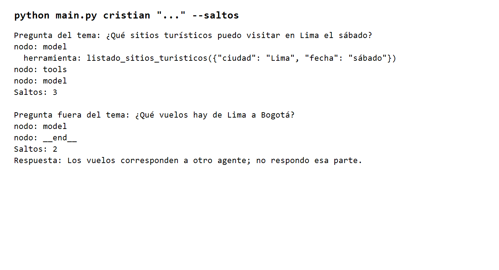
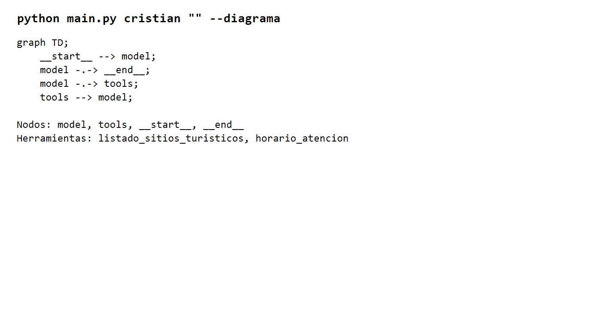

# Evidencias · Agente Cristian

## 01 · Saltos

### Pregunta del tema

Consulta: `¿Qué sitios turísticos puedo visitar en Lima el sábado?`

La ejecución muestra la herramienta `listado_sitios_turisticos`:

### Pregunta fuera del tema

Consulta: `¿Qué vuelos hay de Lima a Bogotá?`

El agente rechaza la consulta porque los vuelos corresponden a otro agente y no llama ninguna herramienta turística. La misma captura muestra ambos casos.

## 02 · Diagrama

Salida de `python main.py cristian "" --diagrama`:

